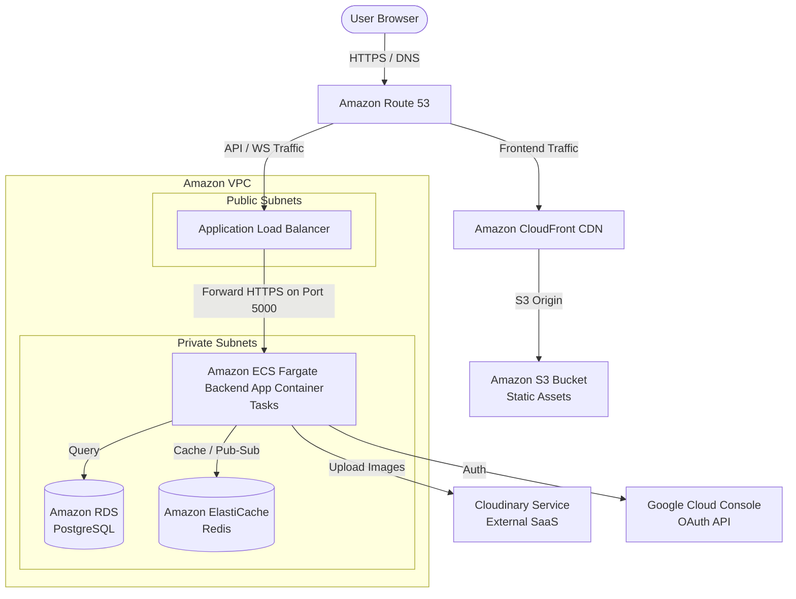

# Connectify — AWS Hosting & Project Completion Guide

This document provides a comprehensive blueprint to complete the remaining parts of the Connectify project, resolve the IP-related rate limiting issues, and deploy the entire stack to **Amazon Web Services (AWS)** using an **Application Load Balancer (ALB)**.

---

## Table of Contents

1. [The "Multiple Requests from Same IP" Issue (Resolved)](#1-the-multiple-requests-from-same-ip-issue-resolved)
2. [What Else is Needed to Complete Connectify](#2-what-else-is-needed-to-complete-connectify)
3. [AWS Production Architecture](#3-aws-production-architecture)
4. [Step-by-Step AWS Deployment Guide](#4-step-by-step-aws-deployment-guide)
5. [Scaling WebSockets behind a Load Balancer](#5-scaling-websockets-behind-a-load-balancer)
6. [Production Environment Variables Cheat Sheet](#6-production-environment-variables-cheat-sheet)

---

## 1. The "Multiple Requests from Same IP" Issue (Resolved)

### Why the Issue Occurs
By default, Express reads the client IP from the immediate incoming socket connection. When deploying behind a reverse proxy or load balancer (like AWS ALB, CloudFront, Nginx, or Cloudflare), the server sees the **load balancer's IP address** as the client's IP. 

Because `express-rate-limit` rate-limits by IP address (`req.ip`), it aggregates all requests from *every user* under the load balancer's IP address. This causes:
- The `apiLimiter` (100 requests per 15 mins) or `authLimiter` (10 requests per 15 mins) to trigger almost immediately.
- Legitimate users receiving `429 Too Many Requests` errors: `"Too many requests from this IP. Please slow down."`

### The Solution (Applied)
We configured Express to trust the `X-Forwarded-For` header set by the load balancer. 
In `server/src/app.js`, we added:

```javascript
const app = express();

// Trust proxy - required for express-rate-limit and cookies behind AWS ALB/CloudFront
app.set('trust proxy', 1); // 1 indicates the server is 1 hop away from the proxy (ALB)
```

> [!IMPORTANT]
> **Security Note:** In production, ensure your backend instances are placed in a **Private Subnet** and only accept traffic from the Application Load Balancer (configured via Security Groups). This prevents malicious clients from spoofing their IP by sending custom `X-Forwarded-For` headers directly to the backend.

---

## 2. What Else is Needed to Complete Connectify

The following checklist is a consolidated list of critical, high, and medium-priority tasks required to make Connectify fully production-ready:

### A. Critical Backend & Schema Tasks
1. **Create the `messages` table in PostgreSQL**:
   Since the app transitioned from MongoDB to PostgreSQL, you must run the following SQL schema update:
   ```sql
   CREATE TABLE IF NOT EXISTS messages (
       id            UUID         PRIMARY KEY DEFAULT gen_random_uuid(),
       room_id       VARCHAR(20)  REFERENCES rooms(id) ON DELETE CASCADE,
       sender_id     UUID         REFERENCES users(id) ON DELETE SET NULL,
       sender_username VARCHAR(50),
       sender_avatar   TEXT,
       content       TEXT         NOT NULL,
       sent_at       TIMESTAMPTZ  DEFAULT NOW()
   );
   CREATE INDEX IF NOT EXISTS idx_messages_room_sent ON messages(room_id, sent_at DESC);
   ```
2. **Hash Refresh Tokens before Storing**:
   In `controllers/authController.js`, refresh tokens are currently stored as plain text. Hash them with SHA-256 before inserting them into `refresh_tokens.token_hash` to protect against database breach leaks.
3. **Remove MongoDB Startup Gate**:
   Clean up `server.js` and delete `mongodb.js` config since messages and rooms are now consolidated in PostgreSQL.

### B. Incomplete Features to Implement
1. **Complete `ManageChatRoomPage.jsx`**:
   The current page uses mock data and `localStorage`. It needs to be rewritten to make actual API calls:
   - `GET /api/v1/rooms/:roomId` to load current details.
   - `PUT /api/v1/rooms/:roomId` to update name, slogan, or description (create this endpoint in `roomController.js`).
   - `DELETE /api/v1/rooms/:roomId/members/:userId` to kick members (create this endpoint in `roomController.js`).
2. **Fix Profile Page Owned Rooms**:
   The `getMyRooms` query in `userController.js` is missing `created_by` and `description` in its select statement. Add these so the frontend can filter and show owned rooms.
3. **Typing Indicator UI**:
   The socket events are wired up (`typing_start`, `typing_stop`), but the frontend `ChatRoomPage.jsx` needs a UI element to display `"{username} is typing..."`.
4. **Message Pagination ("Load More")**:
   Implement a "Load earlier messages" button using the `before` query parameter (cursor pagination) returned by `GET /api/v1/rooms/:roomId/messages`.

---

## 3. AWS Production Architecture

Deploying Connectify requires a scalable, secure network design. Below is the recommended AWS architecture:



---

## 4. Step-by-Step AWS Deployment Guide

### Step 1: Set up the Database (Amazon RDS PostgreSQL)
1. Go to AWS RDS Console and click **Create Database**.
2. Choose **PostgreSQL** (version 15 or 16).
3. Select **Production** or **Free Tier** template based on your budget.
4. Set DB instance identifier (e.g., `connectify-db`), master username (e.g., `postgres`), and master password.
5. In **Connectivity**:
   - Do NOT make it publicly accessible.
   - Put it in the VPC's private subnets.
   - Create a security group `connectify-rds-sg` allowing incoming TCP traffic on port `5432` only from the backend container security group.

### Step 2: Set up Caching & Pub-Sub (Amazon ElastiCache Redis)
1. Go to AWS ElastiCache Console and choose **Redis OSS**.
2. Configure a serverless cache or small node (e.g., `cache.t4g.micro`).
3. Set VPC settings to matching private subnets.
4. Create a security group `connectify-redis-sg` allowing TCP traffic on port `6379` only from the backend container security group.

### Step 3: Containerize the Backend (Docker)
Create a `Dockerfile` in the `/server` directory:

```dockerfile
FROM node:20-alpine
WORKDIR /usr/src/app
COPY package*.json ./
RUN npm ci --only=production
COPY . .
EXPOSE 5000
CMD ["npm", "start"]
```

Build, tag, and push the image to **Amazon ECR (Elastic Container Registry)**:
```bash
# Authenticate Docker to AWS ECR
aws ecr get-login-password --region us-east-1 | docker login --username AWS --password-stdin <YOUR_AWS_ACCOUNT_ID>.dkr.ecr.us-east-1.amazonaws.com

# Build and Push
docker build -t connectify-backend ./server
docker tag connectify-backend:latest <YOUR_AWS_ACCOUNT_ID>.dkr.ecr.us-east-1.amazonaws.com/connectify-backend:latest
docker push <YOUR_AWS_ACCOUNT_ID>.dkr.ecr.us-east-1.amazonaws.com/connectify-backend:latest
```

### Step 4: Deploy Backend on ECS Fargate
1. Create an **ECS Cluster** (Fargate-powered).
2. Define an **ECS Task Definition**:
   - Operating system: Linux.
   - Task execution role: needs permissions to pull from ECR and fetch from Parameter Store/Secrets Manager.
   - Container name: `backend`, image: your ECR image URL.
   - Port mappings: `5000` (TCP).
   - Set environment variables (see [Section 6](#6-production-environment-variables-cheat-sheet)).
3. Create an **ECS Service**:
   - Launch type: **Fargate**.
   - Desired tasks: `2` (for high availability and load testing).
   - Networking: Private Subnets.
   - Security Group `connectify-ecs-sg`: Allow port `5000` from the ALB Security Group.

### Step 5: Configure Application Load Balancer (ALB)
1. Create a **Target Group**:
   - Target type: IP addresses (for Fargate compatibility).
   - Protocol: HTTP, Port: 5000.
   - Health check path: `/health` (interval: 30s, healthy threshold: 2, timeout: 5s).
   - **Crucial step**: Under **Attributes**, enable **Target Group Cookie Stickiness** (sticky sessions).
2. Create an **Application Load Balancer**:
   - Scheme: Internet-facing.
   - Subnets: Choose Public Subnets in at least two Availability Zones.
   - Security Group `connectify-alb-sg`: Allow inbound TCP `80` (HTTP) and `443` (HTTPS) from anywhere (`0.0.0.0/0`).
3. Add Listeners:
   - HTTP Listener (Port 80): Redirects HTTP requests to HTTPS (Port 443).
   - HTTPS Listener (Port 443): Authenticated with an SSL certificate created in **AWS Certificate Manager (ACM)**. Forwards traffic to your target group.

### Step 6: Deploy Frontend (S3 + CloudFront CDN)
1. Update `frontend/.env.production`:
   ```env
   VITE_API_URL=https://api.yourdomain.com
   ```
2. Build the project locally or in CI/CD:
   ```bash
   cd client
   npm install
   npm run build
   ```
3. Create an **Amazon S3 Bucket** (e.g., `connectify-frontend-bucket`). Disable public access.
4. Upload all files inside the `client/dist/` folder to the S3 bucket.
5. Create a **CloudFront Distribution**:
   - Origin Domain: Select your S3 bucket.
   - Origin Access Control (OAC): Enable (highly recommended to restrict direct S3 access). Update the S3 bucket policy to trust CloudFront.
   - Viewer Protocol Policy: Redirect HTTP to HTTPS.
   - **Fallback Routing**: Set Custom Error Page for `404` and `403` to response path `/index.html` with status `200` (required for React Router client-side routing).
   - SSL Certificate: Request an ACM certificate for `yourdomain.com` or `www.yourdomain.com` and attach it.

---

## 5. Scaling WebSockets behind a Load Balancer

WebSockets require special configuration when running multiple container instances behind a load balancer.

### A. Load Balancer Sticky Sessions
Socket.IO starts its connection with HTTP long-polling request handshakes, which it subsequently upgrades to WebSockets. If a client connects to ECS Instance 1 for the handshake and their next upgrade request hits ECS Instance 2, the connection will fail with a `Session ID unknown` error.
- **Fix**: In the AWS ALB Target Group configuration, enable **Stickiness** with type **Load balancer generated cookie** (usually a 1-day duration).

### B. Redis Adapter (Cross-Instance Message Delivery)
If User A is connected to ECS Instance 1 and User B is connected to ECS Instance 2, when User A emits a message, `io.to(roomId).emit(...)` on Instance 1 will NOT send it to User B.
- **Fix**: Connect the Socket.IO server to the Redis Pub/Sub adapter.
- Run `npm install @socket.io/redis-adapter` in the backend.
- Modify `server/src/socket.js` to configure the adapter:

```javascript
const { Server } = require('socket.io');
const { createAdapter } = require('@socket.io/redis-adapter');
const redisClient = require('./config/redis');

const initSocket = (httpServer) => {
  const io = new Server(httpServer, {
    cors: {
      origin: process.env.CLIENT_URL,
      credentials: true
    }
  });

  // Duplicate Redis client for pub/sub (required by node-redis v4+)
  const pubClient = redisClient;
  const subClient = pubClient.duplicate();
  
  subClient.connect().then(() => {
    io.adapter(createAdapter(pubClient, subClient));
    console.log('✅ Socket.IO Redis Adapter Initialised');
  });

  // Keep existing socket logic...
```

---

## 6. Production Environment Variables Cheat Sheet

Configure the following variables in **AWS Secrets Manager** or as **ECS Task Environment Variables**:

| Variable | Target Value / Format | Purpose |
|---|---|---|
| `NODE_ENV` | `production` | Enables performance optimizations |
| `PORT` | `5000` | Backend API port |
| `CLIENT_URL` | `https://yourdomain.com` | CORS configuration |
| `DB_HOST` | `connectify-db.xxxxxx.us-east-1.rds.amazonaws.com` | RDS Postgres host |
| `DB_PORT` | `5432` | Postgres port |
| `DB_NAME` | `connectify` | Database name |
| `DB_USER` | `postgres` | Database master user |
| `DB_PASSWORD` | `<secure password>` | Database master password |
| `REDIS_URL` | `rediss://connectify-redis.xxxxxx.use1.cache.amazonaws.com:6379` | ElastiCache Redis URL (note `rediss://` for TLS) |
| `JWT_ACCESS_SECRET` | `<long-random-string>` | Signing key for Access JWTs |
| `JWT_REFRESH_SECRET` | `<different-long-random-string>` | Signing key for Refresh JWTs |
| `COOKIE_SECRET` | `<long-random-string>` | Cookie signature key |
| `GOOGLE_CLIENT_ID` | From Google Cloud Developer Console | Google OAuth client identity |
| `GOOGLE_CLIENT_SECRET`| From Google Cloud Developer Console | Google OAuth client secret |
| `GOOGLE_CALLBACK_URL`| `https://api.yourdomain.com/api/v1/auth/google/callback` | Redirect URL matching Google Settings |
| `CLOUDINARY_CLOUD_NAME`| Cloudinary config name | CDN for image uploads |
| `CLOUDINARY_API_KEY` | Cloudinary credentials | CDN credentials |
| `CLOUDINARY_API_SECRET`| Cloudinary credentials | CDN credentials |
